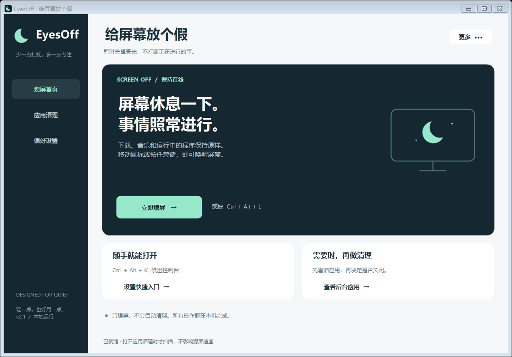

# EyesOff 2.1

轻量 Windows 熄屏工具。本轮重做界面和启动流程，保留原版应用识别、保护名单和结束进程的核心规则。

## 界面预览



*实际控件离屏渲染，不是真实桌面点击验收。*

## 这次改了什么

- **熄屏优先**：默认显示熄屏首页，清理和设置独立分区。
- **深蓝 + 薄荷绿界面**：大按钮、卡片布局、独立月亮图标。
- **按需扫描**：只有进入应用清理页才扫描进程，不再在首页启动时扫描。
- **两个入口**：控制台与直接熄屏分开；直接熄屏不展示主窗口。
- **单实例**：重复打开新版会唤出已有窗口，而非堆积多个进程。旧版不支持此协议，不能自动合并。
- **托盘待命**：默认关闭窗口收到托盘；可选择关闭此行为。右键托盘图标可真正退出。
- **开机启动可选**：偏好设置中主动勾选后，登录 Windows 时静默进入托盘；安装快捷方式不会开启它。

## 使用

1. 下载或克隆源码到打算长期保留的目录，然后运行 `build.bat` 编译生成 `EyesOff.exe`。仓库不提交编译产物。
2. 双击生成的 `EyesOff.exe` 打开控制台。
3. 运行 `install_shortcut.bat`，会为当前用户创建桌面和开始菜单入口。它会替换同名 EyesOff 快捷方式，若要保留旧快捷方式，请先备份。
4. 桌面 **EyesOff 一键熄屏** 打开控制台；**EyesOff 立即熄屏** 直接熄屏。
5. 已有旧版运行时，请在旧版托盘菜单逐个退出，再使用新版，避免热键被旧版占用。

快捷键（需 EyesOff 常驻，且未被其他程序占用）：

| 快捷键 | 操作 |
| --- | --- |
| Ctrl + Alt + L | 熄屏 |
| Ctrl + Alt + K | 打开控制台 |

熄屏指令有约 700 毫秒延迟，让触发操作的鼠标/键盘松开事件先结束。程序不会自动关闭应用；移动鼠标或按键通常可唤醒显示器，具体取决于显示/电源环境。熄屏不是锁屏，也不应当当作隐私锁定措施。

## 命令行入口

- `EyesOff.exe --show`：打开/唤出控制台。
- `EyesOff.exe --off`：不显示主窗口，发送熄屏请求并保持托盘待命；若已有新版，转交请求。
- `EyesOff.exe --tray`：静默进入托盘，已有新版时不重复启动。
- `EyesOff.exe --install-shortcuts`：仅生成快捷方式，不启动界面、不熄屏；结果写入 `shortcut_result.txt`。
- `EyesOff.exe /selftest`：原有只读扫描诊断，会枚举本机进程并写入 `selftest_result.txt`。**可能包含个人路径和软件清单，请勿公开提交。** 本轮未运行这一入口。

## 设置与安全范围

- 保护名单保存在程序同目录的 `protect.txt`。可保留旧文件；示例文件 `protect.example.txt` 不含个人条目。
- 原有设置仍使用当前用户注册表 `HKCU\Software\EyesOff`，包括已有的“允许强制结束”选择；升级不替用户更改该选择。
- 只有主动开启登录启动后，才写入当前用户 `HKCU\Software\Microsoft\Windows\CurrentVersion\Run` 的 `EyesOff` 值。关闭该选项会移除该值。原版和新版共享此键，保留旧版自启配置时请核实偏好设置。
- 强制结束仍需设置开关和每次操作确认。只熄屏不会触发清理。
- 原版扫描/识别/终止规则代码（ProcessScanner、AppModel、AppEndRunner、ProtectList、WindowScanner）本轮未更改。这不代表已做完整安全审计；操作前仍请保存内容。
- 应用不请求管理员权限，也没有新增自动更新、遥测或网络服务。原版风险提示和保护策略不因新 UI 而放宽。

## 构建

本仓库提供源码，无第三方 NuGet 依赖。使用 Windows 上已安装的 .NET Framework 4.x 编译器：

```bat
build.bat
```

脚本优先选择 Framework64，找不到时尝试 Framework。输出 `EyesOff.exe`，含图标和 asInvoker / System-DPI manifest。不覆盖已有 `protect.txt`。本轮在当前 Windows 环境编译通过；其他 Windows / .NET 版本、远程桌面、多显示器及混合 DPI 未验收。

## 非破坏组件测试

```powershell
powershell -NoProfile -ExecutionPolicy Bypass -File .\tests\verify.ps1
```

本轮 **40 项检查通过**，覆盖参数解析、单实例对象/事件路由、首页不扫描、隐藏启动、基础布局、搜索、选中状态和保护条目不可操作等。测试使用虚构应用和 testMode，跳过托盘和热键注册、真实熄屏、真实进程结束及设置写入。组件构造耗时不是完整启动基准。

`previews` 是真实控件的**离屏渲染预览**，并非真实桌面截图或鼠标点击验收。实际 Windows 标题栏和字体渲染可能不同。尚未做真实熄屏、热键、登录启动、多显示器、混合 DPI 或交互式端到端验收。

## Git 需要什么

不使用 Git 也能运行和修改此项目。若要做版本管理：

- 跟踪源码、图标、manifest、构建脚本和测试代码即可；仓库已附 `.gitignore`。
- `protect.txt`、`selftest_result.txt`、本机快捷方式和编译产物不要提交。只提交 `protect.example.txt` 模板。
- 本地记录版本只需要在选定目录初始化仓库，不需要 GitHub 账号。
- 如需推送远程仓库，再配置目标仓库地址、私有/公开范围及相应登录授权；不要把密码或访问令牌写进源码或发在聊天里。
- 公开源码不等于已经选择开源许可证；本仓库暂未指定许可证。对外分发或复用前请核实授权范围，并完成实际运行验证。
